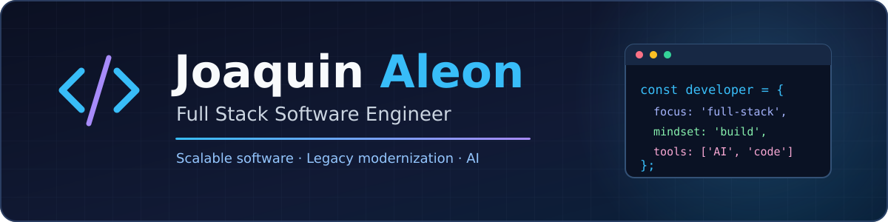

 

### Hey, I'm Joaquin! 👋

**Full Stack Software Engineer** · Rosario, Argentina 🇦🇷

I build and improve software that solves real business problems — from modern web apps to industrial platforms.

---

### 👨‍💻 About me

I'm a **Full Stack Software Engineer with 5+ years of experience** developing, modernizing, and maintaining software for real-world businesses.

I work across the full development lifecycle: understanding requirements, designing solutions, building APIs and interfaces, improving performance, and shipping reliable features. I especially enjoy solving complex problems at the intersection of **software engineering, business processes, and applied AI**.

### ⚡ What I build

| Focus | Experience |
| :--- | :--- |
| 🏭 **Industrial software** | Production monitoring, traceability, operational dashboards, and business indicators. |
| 🏗️ **Modernization** | Refactoring legacy applications, improving architecture, and migrating existing systems. |
| 🌐 **Full Stack development** | Web applications, REST APIs, integrations, and database-driven solutions. |
| 🤖 **AI-assisted engineering** | Generative AI for code analysis, debugging, refactoring, documentation, and workflow improvement. |

### 🛠️ Tech stack

**Frontend**

**Backend & data**

`SQL Server` · `REST APIs` · `System integrations`

**Tools & workflow**

### 🚀 Beyond the code

- 🤝 Work directly with stakeholders to understand needs and define practical solutions.
- ⚙️ Improve performance, maintainability, and developer experience in existing systems.
- 🧠 Explore how AI can support engineers and deliver useful product features — with human review and validation.
- 🌱 Keep learning and adapting to the right tools for each challenge.

### 📈 GitHub activity

---

### 🤝 Let's build something meaningful

Open to discussing interesting projects, collaborations, and software engineering opportunities.

[**Connect on LinkedIn**](https://www.linkedin.com/in/joaquin-andres-aleon/) · [**Send me an email**](mailto:joacoaleon@gmail.com)

Built with curiosity, coffee ☕, and a focus on solving real problems.

